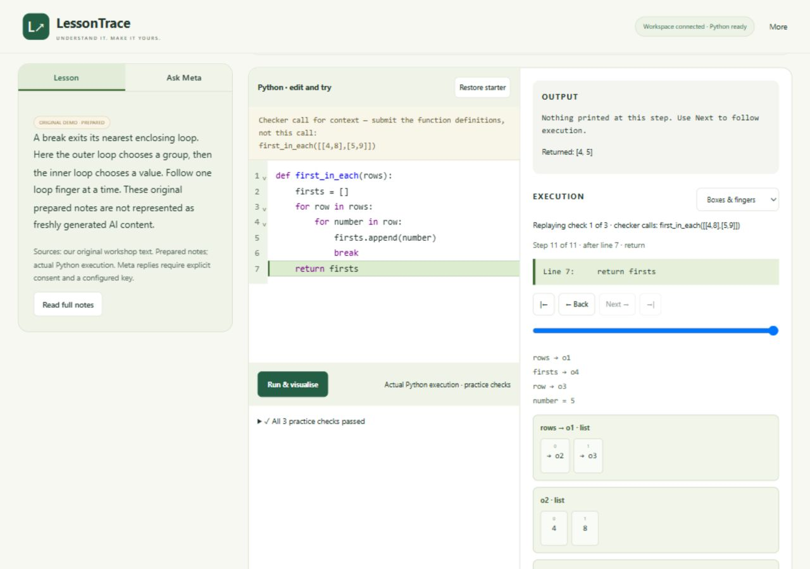

# LessonTrace

**Meta-powered teaching and research agents for learning Python through prediction, execution and debugging.**

LessonTrace uses **bounded Meta teaching and research agents**, source-grounded retrieval (RAG), and real Python execution to help learners move from reading a lesson to attempting a program. The teaching agent chooses a useful next action from an allowed menu; the research agent reads approved sources and prepares focused follow-ups. Learners work through a source-linked course, topic quizzes, an editable Python workspace and step-by-step execution visualisation. **The agents propose. Backend rules decide. Python checks.** This prototype does not claim measured learning gains or certify mastery.

**[Watch the 2:50 demo on YouTube](https://youtu.be/s4TGvUO8VEM)** — unlisted, with English AI narration, actual Meta calls and a completed live Hub research run.



This is the standalone **2026 Meta Global AI Developer Hackathon** submission. The submitted LessonTrace website was built during the hackathon, starting **October 26, 2026**. It runs independently from this public repository.

## Run it

Tested on Windows with **64-bit Python 3.11**. The Python runtime is downloaded from public PyPI; no Docker, private repository, paid deployment or Node build is required to run the app. Allow roughly 200 MB for the first dependency download and extra time for the first runtime compilation.

```powershell
git clone https://github.com/nikhil5562/LessonTrace-Hackathon.git
cd LessonTrace-Hackathon
py -3.11 -m venv .venv
.\.venv\Scripts\python.exe -m pip install -r requirements.txt
.\.venv\Scripts\python.exe -m pip check
Copy-Item .env.example .env
.\.venv\Scripts\python.exe scripts/run.py
```

Open **http://127.0.0.1:8897/#courses**. Wait for **Python ready** before opening a lesson. If that port is in use, run `scripts/run.py --port 8898` and use the matching address. Keep the app bound to this computer; this prototype is not a multi-user hosted service.

On macOS/Linux, the equivalent commands use `python3.11 -m venv .venv`, `.venv/bin/python` and `cp .env.example .env`. This release was verified on Windows; other operating systems have not been acceptance-tested.

### No key needed for the first run

On the course page choose **Open sample →** under **Try the original sample**. Its source, notes and loop examples are original prepared material, explicitly labelled **ORIGINAL DEMO · PREPARED**. Predict what the code prints, inspect the real Python trace, then debug the extra outer `break`. Opening this sample does not grant course prerequisites.

The 24 prepared course lessons also run without a key: read → topic/debug questions → coding checks → next eligible concept. Quizzes can be skipped to inspect the editor; passing the required checks is still necessary to unlock a new course concept. No-key operation is not represented as fresh Meta inference.

### Enable live Meta tutoring with your own key

Edit the local `.env` copied above:

```dotenv
LESSONTRACE_ENABLE_META=1
LESSONTRACE_META_API_KEY=your_own_meta_model_api_key
LESSONTRACE_TEST_LIMIT_CENTS=100
```

Restart the server. In a lesson, choose **Ask Meta**, review the consent text and check the sharing box, then ask a question or request a hint. Open **Live Meta calls** before sending to see the writer and separate explanation-review requests. The UI shows the actual endpoint, model, request status and returned response ID/token counts when supplied. Mock transports are labelled **CONTROLLED TEST**; validation failures before HTTP are **NO HTTP REQUEST SENT**. A response receipt is not evidence of correctness.

The key is read only by the backend from this project's explicit `.env` or environment. It is never sent to browser JavaScript. No shared key, judge login or access code is needed. `.env` is ignored by Git. Never put a real key in `.env.example`, a screenshot or the public video.

The default local allowance reserves **US$0.10 per attempted model request**, including failed requests. A reviewed tutor reply usually needs **two requests**. This is an intentionally conservative local stop, **not an estimate of Meta's actual bill**. Provider-reported tokens and actual dollar billing are different things. A fresh judge installation starts with its own ledger. Restarting preserves reservations. See [configuration and privacy](CONFIGURATION.md).

## What Meta does

All runtime cloud inference in this submission uses **Meta models**. There is no Google/OpenAI/Anthropic inference fallback.

| Feature | Real work performed | Implementation |
|---|---|---|
| Teaching agent | Chooses among backend-permitted teaching actions; explains the learner's question, source passages and selected actual execution state | [`video_learning.py`](server/lessontrace_site/video_learning.py), [`adaptive.py`](server/lessontrace_site/adaptive.py) |
| Independent explanation review | A separate Muse Spark request judges source/claim support before anchored teaching is accepted | [`claim_review.py`](server/lessontrace_site/claim_review.py), [`provider_audit.py`](server/lessontrace_site/provider_audit.py) |
| Lesson Hub research agent | Chooses approved sources, reads bounded passages, can inspect a small Python example, and prepares a focused learning path | [`hub.py`](server/lessontrace_site/hub.py), [`hub_sources.py`](server/lessontrace_site/hub_sources.py) |
| Course preparation workflow | Prepares reusable, versioned Meta-authored base lessons and checked concept follow-ups; opening a saved lesson replays it rather than regenerating it | [`course_agent.py`](server/lessontrace_site/course_agent.py), [`course_service.py`](server/lessontrace_site/course_service.py), [`course_content/`](course_content/) |
| Video import | Creates original notes/practice from available captions for a learner-supplied YouTube URL | [`video_lessons.py`](server/lessontrace_site/video_lessons.py) |

The teaching/review model is **`muse-spark-1.3`** through **`POST https://api.meta.ai/v1/chat/completions`**, implemented in [`meta.py`](server/lessontrace_site/meta.py). The source includes a legacy Meta speech adapter with a controlled wire test; the public sample contains no narration recording and speech is not part of the submitted demonstration. No Meta image-generation model is called. Execution diagrams are drawn from actual Python trace data.

## How the agents use RAG and tools

RAG supplies evidence for teaching. [`retrieval.py`](server/lessontrace_site/retrieval.py) ranks supplied/cached source passages with lexical matching and programming-related query expansion. The tutor receives selected passages together with the learner's question, current code, recent attempts and selected actual Python execution state.

The **teaching agent** chooses one currently eligible action: ask what the learner expected, offer a hint, display a source passage or inspect an observed trace step. The backend performs the chosen action and rejects unavailable actions or invented trace indices. Other supported learning flows can allow a smaller or fresh Python-checked exercise. In the current lesson-first course, help stays on the existing task; optional Hub follow-ups become available after the required topic/debug questions and coding checks pass.

The **Lesson Hub research agent** has a bounded read–observe–decide loop. It chooses sources from a curated catalog, reads selected passages, and can inspect a small example with the Python runner before preparing a focused follow-up. It does not search all YouTube or browse arbitrary websites. [A real recorded Hub run](evaluation/hub-live-2026-11-03.json) completed in 94.3 seconds: source selection, Python tool observation, generated notes/quiz/task and separate support review, with all four Meta request receipts and actual execution results. Course preparation uses a related bounded workflow to create reusable base lessons and separate concept follow-ups; saved lessons are not regenerated for every learner.

Before anchored teaching is accepted, the backend checks source IDs and exact short quotes, executes applicable code examples/tasks, and requires a **separate Meta claim-support review**. That reviewer is an automated check, not another source of truth. Source matching cannot establish every claim, and passing finite Python tests cannot prove complete correctness or student mastery.

## More than a retrieval chatbot

The learning loop is **read → predict → execute → inspect → debug → retry → unlock**. The backend tracks concept prerequisites and actual code checks. The model can suggest an allowed action; it cannot award a pass, invent a successful execution, remove prerequisites or silently change the original lesson. The Python runner checks the program.

The agents are bounded and event-driven, not unrestricted background assistants. They use current lesson state, recorded attempts, preferences and permitted actions. Extra research requires consent, waits for the learner and has a nudge cap. The Hub supplements the course after difficulty; it does not replace the initial lesson with endless extra tasks.

Retrieval is a **small, lexical, source-ID-based system** over supplied/cached passages. It is not an embedding database or a search of all YouTube. Exact quoted anchors, actual execution checks, separate semantic review and prerequisite rules reduce several failure modes; none eliminates hallucination. See [architecture](ARCHITECTURE.md) and [verification design](CLAIM_REVIEW.md).

## Verify the release

```powershell
$env:PYTHONPATH='server'
.\.venv\Scripts\python.exe -m pytest server/tests -q
```

Browser-flow tests additionally need Node and the optional test dependency:

```powershell
npm install --prefix .local/frontend-check jsdom@26.1.0
.\.venv\Scripts\python.exe -m pytest server/tests -q
```

Tests use controlled model responses and **real bounded Python**. They do not consume Meta credits. See [the release checks and honest limits](VALIDATION.md) and [historical evaluation](EVALUATION.md). The bundled editor is reproducible with `npm ci --prefix editor` followed by `node editor/build.mjs`.

A separate [recorded original-sample run](evaluation/live-original-2026-11-03.json) contains an accepted **live Muse Spark tutor reply plus its independent review**, provider-returned response IDs, original input/question and real failing/corrected Python traces. It is recorded evidence, not a live replay or a substitute for showing fresh API calls in the demo video.

The revised **2:50 video** adds a completed [live Hub research run](evaluation/hub-live-2026-11-03.json): Meta chooses two sources, reads selected passages, invokes Python, and prepares a new lesson, quiz and task. Four real request receipts, seven review judgements, source anchors and actual Python results are retained. The 94.3-second research is condensed into labelled actual screens and paused results. An operator test solution passes three generated practice cases; this is not presented as learner mastery. Earlier blocked takes and their fixes are disclosed in the evidence. The [revised video record](evaluation/demo-hub-video-2026-11-03.json) contains its hash, media checks and signed-out playback verification.

The [original tutoring evidence](evaluation/demo-video-2026-11-03.json) retains the two accepted tutoring takes, four request receipts and failing/corrected runs used in both cuts. Its older video hash belongs to the earlier 2:54 export, which is preserved separately. Both cuts identify the Meta agents and October 26 event build date. No measured learning gains are claimed.

## Rights and scope

Our application code is **MIT licensed**. Third-party material retains its own terms. Course files containing CS50 anchors have a separate **CC BY-NC-SA 4.0** content licence; Python documentation and editor/runtime dependencies have separate notices. These assets are **not** all MIT. See [content licensing](CONTENT_LICENSE.md), [third-party notices](THIRD_PARTY_NOTICES.md), and [licence texts](licenses/).

No tutorial footage, full caption downloads, book PDFs, private learner data, private Git history or credentials are distributed. The original demonstration can be recorded entirely from our own source and UI. No external video clips are needed. For importing other material, use content you have permission to process; do not redistribute source recordings simply because a URL is public.

LessonTrace was submitted to the **Indie Developer Track**, under **Build for Your World**, on November 3, 2026. Hosting the app is optional for the submitted workflow; the revised demo video is [available on YouTube](https://youtu.be/s4TGvUO8VEM). Submission does not establish organizer endorsement, a judging result or a ruling that the project qualifies beyond the anti-project list.
